# Dokumentasi Skema Basis Data (PostgreSQL 16+)
## Sistem Terpadu POS Kasir, Stok Gudang, Katalog Produk, dan Penggajian

---

### Daftar Isi
1. [Prinsip Desain & Strategi Identifier](#1-prinsip-desain--strategi-identifier)
2. [Diagram Relasi Antar Entitas (ERD)](#2-diagram-relasi-antar-entitas-erd)
3. [Katalog Tabel & Detail Relasi](#3-katalog-tabel--detail-relasi)
   - [3.1 Tenancy & Hierarki Organisasi](#31-tenancy--hierarki-organisasi)
   - [3.2 Autentikasi & RBAC](#32-autentikasi--rbac)
   - [3.3 Master Produk, Varian & Multi-UOM](#33-master-produk-varian--multi-uom)
   - [3.4 Inventaris, Supplier, PO & Kartu Stok (Ledger)](#34-inventaris-supplier-po--kartu-stok-ledger)
   - [3.5 Pelanggan & Mesin Promosi Marketing](#35-pelanggan--mesin-promosi-marketing)
   - [3.6 Kasir (POS), Manajemen Shift & Pembayaran](#36-kasir-pos-manajemen-shift--pembayaran)
   - [3.7 HR, Absensi, Komisi & Payroll](#37-hr-absensi-komisi--payroll)
4. [Integritas Transaksi ACID & Strategi Concurrency](#4-integritas-transaksi-acid--strategi-concurrency)
5. [Skalabilitas Multi-Tenant & Row-Level Security (RLS)](#5-skalabilitas-multi-tenant--row-level-security-rls)

---

## 1. Prinsip Desain & Strategi Identifier

Skema basis data ini mengombinasikan efisiensi performa internal database dengan keamanan eksposur API publik:

### 1.1 Dual-Identifier Pattern (`BIGSERIAL id` vs `UUID uuid`)
1. **`id BIGSERIAL PRIMARY KEY` (Internal Relational Key):**
   - Digunakan sebagai *Foreign Key (FK)* antartabel di dalam PostgreSQL.
   - **Keuntungan Performa:** Tipe data integer 64-bit (8 bytes) menghasilkan struktur B-Tree index yang jauh lebih padat dibandingkan UUID (16 bytes), mempercepat kueri `JOIN` hingga 3x sampai 4x lipat serta menghemat penggunaan memori RAM buffer cache.
2. **`uuid UUID DEFAULT gen_random_uuid()` (External Public Key):**
   - Digunakan sebagai *Resource Identifier* pada seluruh endpoint REST API publik (contoh: `GET /api/v1/products/8c52d88c-7f55-46aa-b2b9-e483fc51c238`).
   - **Keuntungan Keamanan:** Mencegah serangan enumerasi urutan data (*enumeration/scraping attack*) dan menyembunyikan volume transaksi atau jumlah pengguna asli dari kompetitor.

### 1.2 Standar Presisi Moneter (`BIGINT`)
- Seluruh kolom moneter (harga jual, HPP, diskon, subtotal, gaji pokok, komisi, dan nominal kas) disimpan dalam tipe data `BIGINT` (satuan rupiah terkecil).
- **Aturan Ketat:** Dilarang menggunakan tipe data `FLOAT` atau `DOUBLE` untuk mencegah distorsi pembulatan bilangan pecahan (*floating point precision leak*).

---

## 2. Diagram Relasi Antar Entitas (ERD)

```mermaid
erDiagram
    tenants ||--o{ outlets : "memiliki"
    tenants ||--o{ users : "memiliki"
    tenants ||--o{ products : "memiliki"
    tenants ||--o{ inventory_locations : "memiliki"
    tenants ||--o{ customers : "memiliki"
    tenants ||--o{ promotions : "memiliki"
    tenants ||--o{ pos_orders : "memiliki"
    tenants ||--o{ employees : "memiliki"

    outlets ||--o{ inventory_locations : "menaungi"
    outlets ||--o{ pos_shifts : "lokasi_shift"
    outlets ||--o{ pos_orders : "lokasi_transaksi"
    outlets ||--o{ promotion_outlets : "berlaku_promo"
    outlets ||--o{ employees : "penugasan"

    categories ||--o{ products : "mengelompokkan"
    categories ||--o{ promotion_rules : "kategori_target"
    products ||--o{ product_variants : "memiliki varian"
    product_variants ||--o{ product_uoms : "memiliki satuan UOM"
    product_variants ||--o{ product_cost_history : "riwayat HPP"
    product_variants ||--o{ inventory_stocks : "stok saldo"
    product_variants ||--o{ stock_movements : "mutasi kartu stok"
    product_variants ||--o{ promotion_rules : "varian_target"

    inventory_locations ||--o{ inventory_stocks : "saldo per lokasi"
    inventory_locations ||--o{ stock_movements : "jejak mutasi"
    inventory_locations ||--o{ purchase_orders : "tujuan kirim"
    inventory_locations ||--o{ stock_opnames : "lokasi audit"

    suppliers ||--o{ purchase_orders : "pemasok"
    purchase_orders ||--o{ purchase_order_items : "item PO"

    promotions ||--o{ promotion_outlets : "daftar_cabang"
    promotions ||--o{ promotion_rules : "daftar_aturan"
    promotions ||--o{ promotion_usage_logs : "audit_pemakaian"
    promotions ||--o{ pos_orders : "promo_nota"
    promotions ||--o{ pos_order_items : "promo_item"
    customers ||--o{ pos_orders : "pelanggan_transaksi"
    customers ||--o{ promotion_usage_logs : "riwayat_pelanggan"

    users ||--o{ pos_shifts : "kasir pembuka"
    users ||--o{ pos_orders : "kasir pemroses"
    pos_shifts ||--o{ pos_orders : "menaungi transaksi"
    pos_shifts ||--o{ pos_shift_cash_logs : "kas masuk/keluar"

    pos_orders ||--o{ pos_order_items : "rincian barang"
    pos_orders ||--o{ pos_order_payments : "pembayaran split"
    pos_payment_methods ||--o{ pos_order_payments : "metode bayar"
    pos_orders ||--o{ payroll_commissions_pending : "komisi penjualan"

    employees ||--o{ salary_structures : "struktur gaji"
    employees ||--o{ attendance_logs : "riwayat absensi"
    employees ||--o{ payroll_commissions_pending : "penerima komisi"
    employees ||--o{ payroll_snapshots : "slip gaji final"

    payroll_periods ||--o{ payroll_snapshots : "periode penggajian"
    payroll_snapshots ||--o{ payroll_item_snapshots : "rincian slip"
```



---

## 3. Katalog Tabel & Detail Relasi

File DDL lengkap tersedia di [database/schema.sql](file:///Users/handokodenih/DEV/umkm_pos/database/schema.sql). Berikut adalah penjelasan struktur tiap domain:

### 3.1 Tenancy & Hierarki Organisasi

#### 1. `tenants`
Menyimpan identitas entitas bisnis atau perusahaan utama.
- `id` (BIGSERIAL, PK): ID internal relasional.
- `uuid` (UUID, UNIQUE): ID publik tenant.
- `code` (VARCHAR(50), UNIQUE): Kode unik tenant (contoh: `sumber-berkah`).
- `name` (VARCHAR(255)): Nama perusahaan / pemilik usaha.
- `status` (VARCHAR(30)): Status akun (`ACTIVE`, `SUSPENDED`, `TRIAL`).
- `subscription_plan` (VARCHAR(50)): Paket langganan SaaS.

#### 2. `outlets`
Menyimpan data cabang fisik toko atau outlet penjualan.
- `id` (BIGSERIAL, PK)
- `uuid` (UUID)
- `tenant_id` (BIGINT, FK -> `tenants.id` ON DELETE CASCADE)
- `code` (VARCHAR(50)): Kode cabang (contoh: `CAB-SBY-01`).
- `name` (VARCHAR(255)): Nama cabang (contoh: `Toko Surabaya Rungkut`).
- `is_main_branch` (BOOLEAN): Penanda apakah cabang ini adalah toko pusat.
- **Constraint Unik:** `UNIQUE(tenant_id, code)` dan `UNIQUE(tenant_id, uuid)`.

#### 3. `inventory_locations`
Menyimpan titik fisik penyimpanan barang (Gudang, Display Kasir, Gudang Transit).
- `id` (BIGSERIAL, PK)
- `uuid` (UUID)
- `tenant_id` (BIGINT, FK -> `tenants.id`)
- `outlet_id` (BIGINT, FK -> `outlets.id`)
- `code` (VARCHAR(50)): Kode lokasi (contoh: `GUDANG-PUSAT`, `DISPLAY-KASIR`).
- `name` (VARCHAR(100)): Nama fisik lokasi.
- `type` (VARCHAR(30)): Klasifikasi lokasi (`WAREHOUSE`, `STORE_FRONT`, `TRANSIT`, `DAMAGED`).

---

### 3.2 Autentikasi & RBAC

#### 4. `roles` & 5. `permissions` & 6. `role_permissions`
Mengatur hak akses secara granular di seluruh sistem backend dan antarmuka.
- Tabel `roles` memiliki kolom `tenant_id` (bernilai `NULL` untuk role bawaan sistem, atau terikat `tenant_id` untuk kustomisasi role per bisnis).
- Relasi many-to-many antara role dan permission dikelola oleh `role_permissions (role_id, permission_id)`.

#### 7. `users` & 8. `user_outlets`
Menyimpan kredensial staf dan hak akses toko.
- `id` (BIGSERIAL, PK)
- `uuid` (UUID)
- `tenant_id` (BIGINT, FK -> `tenants.id`)
- `role_id` (BIGINT, FK -> `roles.id`)
- `username` (VARCHAR(100))
- `password_hash` (VARCHAR(255)): Enkripsi Argon2id / Bcrypt.
- `pin_hash` (VARCHAR(255)): PIN 6 digit untuk buka/tutup shift kasir dan absensi cepat.
- `user_outlets`: Memetakan cabang-cabang mana saja yang boleh diakses oleh pengguna bersangkutan.

---

### 3.3 Master Produk, Varian & Multi-UOM

#### 9. `categories` & 10. `products`
Katalog induk pengelompokan barang.
- `categories.parent_id`: Mendukung hierarki kategori bertingkat tak terbatas (contoh: Makanan -> Camilan -> Biskuit).
- `products`: Menyimpan nama umum produk, deskripsi, dan foto utama.

#### 11. `product_variants`
Menyimpan unit stok terkecil (Stock Keeping Unit / SKU).
- `id` (BIGSERIAL, PK)
- `uuid` (UUID)
- `product_id` (BIGINT, FK -> `products.id` ON DELETE CASCADE)
- `sku` (VARCHAR(64)): Nomor SKU unik per tenant (`UNIQUE(tenant_id, sku)`).
- `barcode` (VARCHAR(64)): Barcode kemasan satuan eceran (EAN-13 / Code-128) untuk pemindaian instan kasir dan rak display.
- `base_cost_price` (BIGINT): HPP dasar per satuan terkecil.
- `base_sell_price` (BIGINT): Harga jual per satuan terkecil.
- `min_stock_alert` (BIGINT): Ambang batas peringatan stok menipis.

#### 12. `product_uoms` (Multi-Satuan Bertingkat & Barcode Kemasan Grosir)
Menghubungkan penjualan dan pemindaian stok kemasan grosir ke satuan dasar eceran:
- `variant_id` (BIGINT, FK -> `product_variants.id`)
- `uom_name` (VARCHAR(50)): Nama satuan (contoh: `Dus`, `Karton`, `Pak`).
- `conversion_rate` (INT): Rasio pengali terhadap satuan dasar (contoh: 1 Dus = 12 Pcs).
- `sell_price` (BIGINT): Harga jual khusus satuan tersebut.
- `barcode` (VARCHAR(64)): Barcode khusus kardus/dus kemasan luar (ITF-14 / Code-128). Saat dipindai di POS atau Stock Opname, otomatis mengalikan jumlah hitung dengan `conversion_rate` tanpa perlu membuka kardus.
- `is_base_uom` (BOOLEAN): Penanda apakah satuan ini merupakan satuan dasar (`Pcs`).
- `is_base_uom` (BOOLEAN): Penanda apakah satuan ini merupakan satuan dasar (`Pcs`).

#### 13. `product_cost_history`
Merekam jejak pergerakan HPP setiap kali ada penerimaan barang baru (metode Moving Average).
- Menghitung HPP baru:
  $$\text{HPP Baru} = \frac{(\text{Stok Lama} \times \text{HPP Lama}) + (\text{Qty Masuk} \times \text{Harga Beli Baru})}{\text{Stok Lama} + \text{Qty Masuk}}$$

---

### 3.4 Inventaris, Supplier, PO & Kartu Stok (Ledger)

#### 14. `suppliers`
Data pemasok barang untuk pengadaan (Purchase Order).

#### 15. `inventory_stocks` (Saldo Stok Realtime)
Menyimpan saldo kuantitas barang fisik saat ini di setiap lokasi.
- `location_id` (BIGINT, FK -> `inventory_locations.id`)
- `variant_id` (BIGINT, FK -> `product_variants.id`)
- `quantity` (BIGINT): Jumlah stok dalam satuan dasar terkecil.
- **Constraint Unik:** `UNIQUE(tenant_id, location_id, variant_id)`.

#### 16. `stock_movements` (Kartu Stok / Ledger Abadi)
Tabel mutasi yang bersifat **append-only (immutable)**. Tidak boleh dilakukan `UPDATE` atau `DELETE`.
- `movement_type` (VARCHAR(40)):
  - `IN_PURCHASE_ORDER`: Barang masuk dari PO supplier.
  - `OUT_POS_SALE`: Pemotongan stok otomatis akibat transaksi kasir.
  - `TRANSFER_OUT` & `TRANSFER_IN`: Mutasi antarlokasi/cabang.
  - `ADJUSTMENT_OPNAME`: Penyesuaian fisik hasil stock opname.
  - `RETURN_SALE`: Retur barang dari pelanggan.
  - `RETURN_SUPPLIER`: Pengembalian barang rusak ke supplier.
- `quantity_change` (BIGINT): Nilai mutasi (+ untuk masuk, - untuk keluar).
- `balance_after` (BIGINT): Saldo stok sesaat setelah baris ini dicatat.
- `cost_price` (BIGINT): Nilai HPP pada saat mutasi dicatat.
- `reference_uuid` (UUID): UUID dokumen rujukan untuk keperluan audit.

#### 17. `purchase_orders` & 18. `purchase_order_items`
Dokumen pengadaan barang ke supplier dari draft hingga barang diterima di gudang.

#### 19. `stock_transfers` & 20. `stock_transfer_items`
Mutasi barang antarlokasi fisik dengan status pengiriman (`PENDING` -> `IN_TRANSIT` -> `RECEIVED`).

#### 21. `stock_opnames` & 22. `stock_opname_items`
Pencatatan hasil hitung fisik barang di rak gudang vs stok sistem. Perubahan kartu stok baru dieksekusi setelah status opname diubah menjadi `APPROVED`.

#### 23. `stock_opname_scans` (Audit Log Pemindaian Fisik)
Menyimpan riwayat setiap ketukan/tembakan pemindai barcode secara granular saat stock opname berlangsung di lapangan:
- `opname_id` (BIGINT, FK -> `stock_opnames.id` ON DELETE CASCADE)
- `variant_id` (BIGINT, FK -> `product_variants.id`)
- `uom_id` (BIGINT, FK -> `product_uoms.id`): Satuan kemasan yang dipindai (misal Pcs atau Dus).
- `scanned_barcode` (VARCHAR(64)): Teks barcode riil yang terbaca oleh scanner.
- `quantity_counted` (BIGINT): Angka kuantitas yang dimasukkan.
- `base_quantity_counted` (BIGINT): Kuantitas yang dinormalisasi ke satuan dasar terkecil.
- `scanned_by` (BIGINT, FK -> `users.id`): Identitas staf yang melakukan scan.
- `device_id` (VARCHAR(100)): ID perangkat HP / scanner untuk audit jejak fisik.

---

### 3.5 Pelanggan & Mesin Promosi Marketing

#### 23. `customers`
Menyimpan basis data pelanggan toko dan program loyalitas:
- `id` (BIGSERIAL, PK)
- `uuid` (UUID)
- `tenant_id` (BIGINT, FK -> `tenants.id` ON DELETE CASCADE)
- `code` (VARCHAR(50)): Kode unik member (contoh: `MBR-0089`).
- `name` (VARCHAR(255)): Nama pelanggan.
- `phone` (VARCHAR(30)): Nomor telepon unik per tenant (`UNIQUE(tenant_id, phone)`).
- `member_tier` (VARCHAR(50)): Tingkatan loyalitas (`REGULAR`, `SILVER`, `GOLD`, `PLATINUM`).
- `total_spend` (BIGINT): Akumulasi nilai belanja historis untuk perhitungan kenaikan tier.

#### 24. `promotions`
Menyimpan konfigurasi header kampanye promosi dan diskon:
- `id` (BIGSERIAL, PK)
- `uuid` (UUID)
- `tenant_id` (BIGINT, FK -> `tenants.id` ON DELETE CASCADE)
- `code` (VARCHAR(50)): Kode promosi atau kupon unik (`UNIQUE(tenant_id, code)`).
- `promo_type` (VARCHAR(30)): Tipe aktivasi (`AUTOMATIC` jika tanpa kode kupon, `COUPON_CODE` jika memerlukan input kupon).
- `discount_type` (VARCHAR(30)): Formula diskon (`PERCENTAGE`, `FIXED_AMOUNT`, `BUY_X_GET_Y`, `SPECIAL_PRICE`).
- `discount_value` (BIGINT): Nilai potongan (contoh: 15 untuk 15%, atau 10000 untuk Rp 10.000).
- `max_discount_amount` (BIGINT): Batas atas potongan rupiah untuk tipe persentase.
- `min_order_amount` (BIGINT): Syarat minimal nilai belanja nota.
- `target_scope` (VARCHAR(30)): Lingkup sasaran (`ENTIRE_TRANSACTION`, `SPECIFIC_PRODUCTS`, `SPECIFIC_CATEGORIES`).
- **Dimensi Waktu & Kalender:**
  - `start_date` dan `end_date`: Periode tanggal aktif.
  - `start_time` dan `end_time`: Jam mulai dan selesai untuk promo Happy Hour.
  - `days_of_week`: Filter hari (contoh: `6,7` khusus akhir pekan, atau `ALL`).
  - `days_of_month`: Filter tanggal bulanan (contoh: `25,26,27,28,29,30` khusus promo gajian).
  - `applicable_months`: Filter bulan spesifik (contoh: `3,4` untuk Ramadhan).
- **Pengendalian Kuota & Subsidi Budget:**
  - `total_quota` & `daily_quota`: Batas maksimal pemakaian transaksi.
  - `per_customer_quota`: Batas pemakaian per pelanggan/member.
  - `total_budget` & `current_spend_amount`: Plafon dan realisasi anggaran subsidi diskon toko.

#### 25. `promotion_outlets`
Tabel relasi many-to-many antara promosi dan cabang toko. Jika kosong, promosi otomatis berlaku untuk seluruh outlet tenant.

#### 26. `promotion_rules`
Mengatur rincian produk target, aturan inklusi/eksklusi, kuantitas berjenjang (tiered pricing), serta promo Beli X Gratis Y:
- `rule_type`: `INCLUDE_CATEGORY`, `EXCLUDE_CATEGORY`, `INCLUDE_PRODUCT`, `EXCLUDE_PRODUCT`, `BUY_X_GET_Y`, `TIERED_QTY`.
- `buy_variant_id` & `buy_quantity`: Syarat pembelian item untuk promo bundle.
- `reward_variant_id` & `reward_quantity`: Hadiah gratis yang diterima pelanggan.
- `tier_min_qty`, `tier_max_qty`, & `tier_discount_value`: Penentuan diskon kuantitas bertingkat.

#### 27. `promotion_usage_logs`
Merekam jejak audit setiap kali promosi diaplikasikan pada transaksi checkout kasir, mencatat order ID, customer ID, dan nominal potongan rupiah untuk mencegah penyalahgunaan kuota.

---

### 3.6 Kasir (POS), Manajemen Shift & Pembayaran

#### 28. `pos_shifts` & 29. `pos_shift_cash_logs`
Mengontrol laci uang fisik kasir:
- `starting_cash`: Modal uang kecil saat buka kasir.
- `expected_cash`: Kalkulasi sistem otomatis:
  $$\text{Expected Cash} = \text{Starting Cash} + \text{Cash Sales} + \sum \text{Cash In} - \sum \text{Cash Out}$$
- `actual_cash`: Jumlah uang fisik yang dihitung kasir saat tutup toko.
- `cash_discrepancy`: Selisih lebih atau kurang uang kasir.

#### 30. `pos_payment_methods`
Daftar kanal bayar yang didukung (`CASH`, `QRIS`, `DEBIT_CARD`, `CREDIT_CARD`, `BANK_TRANSFER`).

#### 31. `pos_orders`
Header transaksi penjualan kasir.
- `idempotency_key` (UUID, UNIQUE per tenant): Kunci idempotensi dari Flutter untuk mencegah pesanan ganda saat retry jaringan.
- `salesperson_user_id` (BIGINT, FK -> `users.id`): Staf yang berhak mendapatkan komisi dari transaksi ini.
- `customer_id` (BIGINT, FK -> `customers.id`): Relasi pelanggan/member terdaftar.
- `promotion_id` (BIGINT, FK -> `promotions.id`): Promosi nota yang aktif pada pesanan ini.
- `coupon_code` (VARCHAR(50)): Kode kupon jika digunakan.
- `discount_amount` (BIGINT): Total potongan harga keseluruhan.
- `promotion_discount_amount` (BIGINT): Potongan harga yang dihasilkan dari mesin promosi.
- `location_id` (BIGINT, FK -> `inventory_locations.id`): Lokasi stok yang dikurangi.

#### 32. `pos_order_items` & 33. `pos_order_payments`
- `pos_order_items`: Menyimpan kuantitas dalam UOM transaksi dan `base_quantity` untuk kartu stok, merekam `unit_cost_price` (HPP), serta `promotion_id` dan `promotion_discount_amount` jika diskon berlaku per item barang.
- `pos_order_payments`: Mendukung metode pembayaran split (sebagian tunai, sebagian QRIS).

---

### 3.7 HR, Absensi, Komisi & Payroll

#### 34. `employees` & 35. `salary_structures`
Data master karyawan dan formula kompensasi:
- `basic_salary`: Gaji pokok.
- `commission_rate_percent`: Persentase komisi dari transaksi penjualan kasir yang ditangani.
- `commission_fixed_per_item`: Nominal komisi flat per produk tertentu.
- `bpjs_health_deduction` & `bpjs_employment_deduction`: Potongan iuran jaminan sosial.

#### 36. `attendance_logs`
Rekam absensi harian via tablet kiosk kasir (dilengkapi foto selfie liveness, menit keterlambatan, dan lembur).

#### 37. `payroll_commissions_pending`
Antrean komisi penjualan yang otomatis terisi ketika `pos_orders` sukses di-checkout.

#### 38. `payroll_periods`, 39. `payroll_snapshots` & 40. `payroll_item_snapshots`
Penggajian bulanan dengan sistem snapshot permanen:
- Saat periode diubah menjadi `FINALIZED`, data nominal gaji, tunjangan, dan komisi disalin ke `payroll_snapshots`.
- **Karakteristik Immutability:** Kenaikan gaji atau pembaruan struktur gaji di masa depan tidak akan memengaruhi data slip gaji bulan-bulan sebelumnya yang telah di-finalize.

---

## 4. Integritas Transaksi ACID & Strategi Concurrency

Berikut adalah alur transaksi atomik tunggal saat kasir menekan tombol "Bayar" di aplikasi Flutter POS:

```
[Flutter POS Client]
        |
        | 1. POST /api/v1/pos/orders/checkout
        |    Header: Idempotency-Key: <UUID>
        |    Body: Cart Items, Outlet ID, Customer ID, Coupon Code (Opsional)
        v
[Go Gin Backend Service]
        |
        | 2. BEGIN TRANSACTION (PostgreSQL)
        |
        +---> 3. Cek Idempotency Key:
        |        Jika key sudah ada, kembalikan response sebelumnya (Rollback & Return).
        |
        +---> 4. PESSIMISTIC LOCKING PADA STOK:
        |        SELECT id, quantity 
        |        FROM inventory_stocks 
        |        WHERE tenant_id = $1 AND location_id = $2 AND variant_id = $3
        |        FOR UPDATE;
        |        Validasi kecukupan stok -> Jika kurang: RAISE EXCEPTION 'INSUFFICIENT_STOCK'.
        |
        +---> 5. EVALUASI & LOCK KUOTA PROMOSI (Jika Promo Berlaku):
        |        SELECT id, current_usage_count, total_quota, total_budget, current_spend_amount
        |        FROM promotions
        |        WHERE id = $promo_id AND is_active = TRUE
        |        FOR UPDATE;
        |        - Validasi kuota transaksi: (current_usage_count < total_quota).
        |        - Validasi plafon budget: (current_spend_amount + discount <= total_budget).
        |        - UPDATE promotions SET current_usage_count = current_usage_count + 1,
        |                                current_spend_amount = current_spend_amount + discount.
        |        - INSERT INTO promotion_usage_logs (order_id, customer_id, discount_amount).
        |
        +---> 6. UPDATE inventory_stocks
        |        SET quantity = quantity - order_qty;
        |
        +---> 7. INSERT INTO stock_movements (OUT_POS_SALE)
        |        Mencatat mutasi kartu stok dengan balance_after terbaru.
        |
        +---> 8. INSERT INTO pos_orders & pos_order_items & pos_order_payments
        |        Menyimpan dokumen penjualan dengan rincian promo dan split payment.
        |
        +---> 9. Kalkulasi Komisi Sales:
        |        INSERT INTO payroll_commissions_pending (order_id, employee_id, amount).
        |
        +---> 10. COMMIT TRANSACTION;
        v
[Response 200 OK + Payload Struk ESC/POS ke Flutter]
```

---

## 5. Skalabilitas Multi-Tenant & Row-Level Security (RLS)

### 5.1 Isolasi Data pada Mode Single-Tenant
Saat dijalankan untuk satu toko/bisnis, aplikasi menggunakan default ID pada environment:
```env
APP_MODE=single-tenant
DEFAULT_TENANT_ID=1
DEFAULT_TENANT_UUID=00000000-0000-0000-0000-000000000001
```
Middleware secara otomatis mengisikan `tenant_id = 1` ke setiap kueri repository.

### 5.2 Evolusi ke Multi-Tenant (SaaS) Menggunakan Row-Level Security (RLS)
Saat beralih ke multi-tenant SaaS, PostgreSQL Row-Level Security dapat diaktifkan pada tabel-tabel utama tanpa mengubah struktur kolom atau DDL tabel:

```sql
-- Mengaktifkan RLS pada tabel transaksi kasir
ALTER TABLE pos_orders ENABLE ROW LEVEL SECURITY;

-- Kebijakan isolasi ketat: User hanya dapat melihat data sesuai tenant aktifnya
CREATE POLICY tenant_isolation_policy ON pos_orders
    FOR ALL
    USING (tenant_id = NULLIF(current_setting('app.current_tenant_id', true), '')::BIGINT);
```

Sebelum mengeksekusi kueri, koneksi Go Gin mengeset variabel session:
```sql
SET LOCAL app.current_tenant_id = '123';
```
Dengan mekanisme ini, kebocoran data antartenant dicegah langsung di level mesin database.
